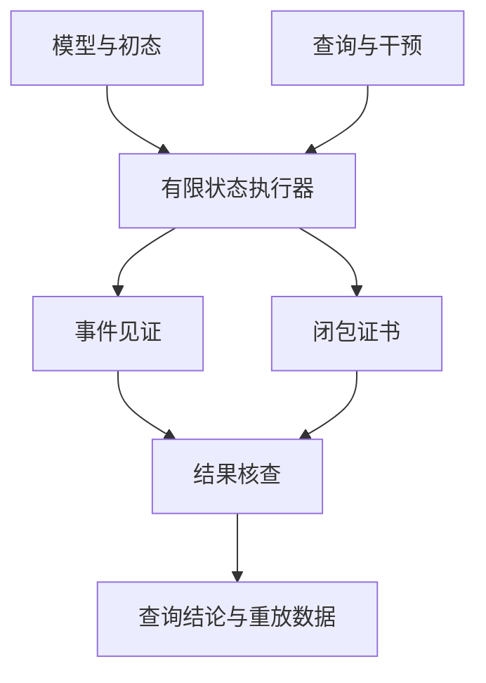

# Molish

Molish 是一门描述、查询和重放分子与细胞机制的声明式语言。模型用稳定的实体 ID 表示分子、复合体和区室，用关系、状态变量和计数器描述初态，再声明哪些条件允许一步机制变化，以及这一步会改变什么。

Molish 的执行器可以回答“这一步能发生吗”“禁止某条规则之后，目标状态还能到达吗”。可达结果附带可重放的事件见证，不可达结果可用闭包证书核对。经验证的轨迹也可以作为 Molstage 等可视化工具的输入，让动画中的变化对应到模型里的实体与规则。

仓库包含 **0.4 规范草案**、**0.3 有限状态执行核心**、Python 参考实现、可复现的酶促事件示例，以及独立的 TypeScript 空间群体运行时。[Molish 0.4 语言规范](engine/Molish-0.4-spec.md)

## 主要能力

| 能力 | 在模型中如何使用 |
| --- | --- |
| 带类型的机制模型 | 用实体、关系、槽和有界计数表达结合、转运、调节和计量变化。 |
| 可复用的规则 | 规则模板为参与者声明类型。模块的启用条件与规则自身的条件在同一前态求值，通过后一起提交效果。 |
| 区室与有方向的结构 | 表达实体所属的区室、区室间允许的转移，以及轨道上的方向、邻接和区间。 |
| 查询与干预 | 从给定初态搜索目标。比较禁用规则或特定规则绑定前后的可达性。 |
| 证据与来源 | 为规则保留假设、观测或文献来源，并在指定上下文下检查哪些断言适用。 |
| 定义复用与跨层映射 | 锁定定义版本，为多个实例复用定义，并核查一条细粒度轨迹投影到粗粒度模型后的行为。 |
| 重放与交换 | 用确定性 CBOR 编码封包，通过 SHA-256 将结果绑定到模型与查询。已核查的状态和事件可导出给外部工具。 |

### 模型、查询与验证



0.4 在有限状态核心之上增加定义锁、来源、跨层投影和应用封包。模型、查询与结果分别记录摘要。修改模型、适用条件或干预之后，旧结果仍能对应到它原来的输入。

## 快速开始

使用 Python 3.9 或更新版本。参考实现只依赖 Python 标准库。

```sh
git clone https://github.com/Waylon524/Molish.git
cd Molish
python3 engine/export_enzyme.py enzyme-trace.json
```

生成的 `enzyme-trace.json` 包含正常反应和禁用转化两种情况。仓库也提供一份可以直接阅读的默认输出。[示例输入](engine/enzyme.json) · [示例输出](engine/enzyme-trace.json)

### 一个基质酶促事件

示例从一个逻辑区室和 3 个游离底物开始。模型用同一个实体 ID `101` 跟踪酶在各步中的状态。

| 步骤 | 机制状态 | 游离底物 | 已释放产物 |
| --- | --- | ---: | ---: |
| 初态 | 酶游离 | 3 | 0 |
| 结合 | 酶结合一个底物 | 2 | 0 |
| 转化 | 已结合的底物变为产物 | 2 | 0 |
| 释放 | 酶释放一个产物 | 2 | 1 |

禁用转化规则后，模型仍可到达结合状态。导出会给出到达结合的事件见证，以及一份单独的闭包证书，用于核对释放目标不可达。四个阶段描绘的是一次示意酶促事件，计数是该模型里的离散值。

### 自定义输入

示例导出器接受一个小型 JSON 输入。它用这些参数编译示例机制，模型中的结合、转化和释放规则由导出器提供。

```json
{
  "entityId": 101,
  "region": "matrix",
  "initialSubstrate": 3
}
```

将参数保存为 `my-enzyme.json`，然后运行下面的命令。

```sh
python3 engine/export_enzyme.py --source my-enzyme.json my-trace.json
```

`entityId` 和 `initialSubstrate` 是正的 32 位无符号整数，`region` 是非空逻辑区室名。省略输出路径时，导出器把 JSON 写到标准输出。

### 读取结果

- `scenarios.normal` 和 `scenarios.blocked` 分别对应正常路径和禁用转化后的路径。
- `steps` 按逻辑顺序给出酶 ID、阶段、底物和产物计数、触发规则及证据。
- `modelDigest`、`queryDigest` 和 `resultDigest` 分别绑定模型、重放查询与重放结果。`caseId` 标识本次轨迹的初态。
- `targetReached` 回答释放目标能否到达。`targetQueryDigest` 和 `targetResultDigest` 绑定释放目标的查询与结果。禁用转化时，结合见证与释放的闭包证书有各自的查询和结果摘要。
- `proof` 保留十六进制形式的 CBOR 封包，可用参考实现核对事件见证及闭包证书。

## 与可视化工具集成

播放器可以用稳定的实体 ID 把屏幕中的一个对象绑定到 `steps` 中的轨迹，用区室名匹配场景里的合法区域。逻辑步、画面插值和播放时间分别处理，同一轨迹可以适配不同的几何场景。场景可另外声明由合法区域、数量与随机种子控制的背景粒子，机制状态由轨迹定义。

规范的第 5 节还定义了绑定模型、查询、结果和案例的 3D 重放清单，以及带证据引用的知识图谱快照。几何资产与视觉时间表由可视化宿主管理。示例导出器提供便于查看和接入的 JSON。[重放与输出规范](engine/Molish-0.4-spec.md#5-输出时间与定量边界)

### 在合法区域内生成群体

TypeScript 运行时从粒子数量、半径、最大步长与随机种子生成固定步长的轨迹，无需逐个指定初始坐标。宿主提供区域边界和球体容纳检查。若宿主提供沿线段扫过的球体检查，粒子可以向合法区域内部移动，同时保证插值路径遵守边界。在相同配置、区域检查与运行环境下，种子可以复现初始分布和移动过程。运行时独立于 Three.js 等渲染库。[空间群体运行时说明](spatial/README.md)

## 仓库结构

| 文件 | 用途 |
| --- | --- |
| [`engine/Molish-0.4-spec.md`](engine/Molish-0.4-spec.md) | 0.4 封包、定义、证据、跨层投影及 0.3 核心语义 |
| [`engine/finite03.py`](engine/finite03.py) | 0.3 状态、守卫、原子状态更新与搜索 |
| [`engine/molish04.py`](engine/molish04.py) | 0.4 封包、装配、结果验证、投影与快照 |
| [`engine/export_enzyme.py`](engine/export_enzyme.py) | 编译示例、验证见证和闭包证书、导出播放数据 |
| [`engine/verify03.py`](engine/verify03.py)、[`engine/verify04.py`](engine/verify04.py) | 规范验收脚本与编码向量检查 |
| [`engine/test_enzyme.py`](engine/test_enzyme.py) | 模块守卫、个体身份、计量与干预回归测试 |
| [`spatial/`](spatial/) | 空间群体的初始化、固定步更新与插值 |

## 运行检查

在仓库根目录运行以下命令。

```sh
python3 engine/verify03.py
python3 engine/verify04.py
python3 -m unittest discover -s engine
```

两个规范脚本以 JSON 输出检查结果及编码向量，当前分别有 42 项和 48 项检查。单元测试另包含 6 项回归检查。以下命令核对仓库中的默认轨迹是否可逐字节重建。

```sh
python3 engine/export_enzyme.py | cmp - engine/enzyme-trace.json
```

## 当前范围

- 参考实现面向小型、显式枚举初态的有限状态模型。0.4 草案的完整互操作性和大规模模型性能仍待验证。
- 闭包证书支持它绑定的模型、初态和查询。单条跨层投影支持核查那条轨迹，跨初态结论需要相应的证书。
- 教学轨迹用逻辑步描述过程。连续坐标、扩散、化学速率和物理时间由外部呈现或定量配置定义。
- 当前 SBML 和 BNGL 接口提供定量适配资格检查。完整的模型转换与数值模拟由各自的适配器或模拟器承担。

## 贡献

欢迎提交最小可复现的机制模型、编码或验证错误，以及需要澄清的规范条文。报告语义问题时，请附上初始状态、查询、适用干预和预期结果。修改封包或规则语义时，请同时更新规范、编码向量和相应测试。

## 许可证

Molish 使用 [Apache License 2.0](LICENSE)。
